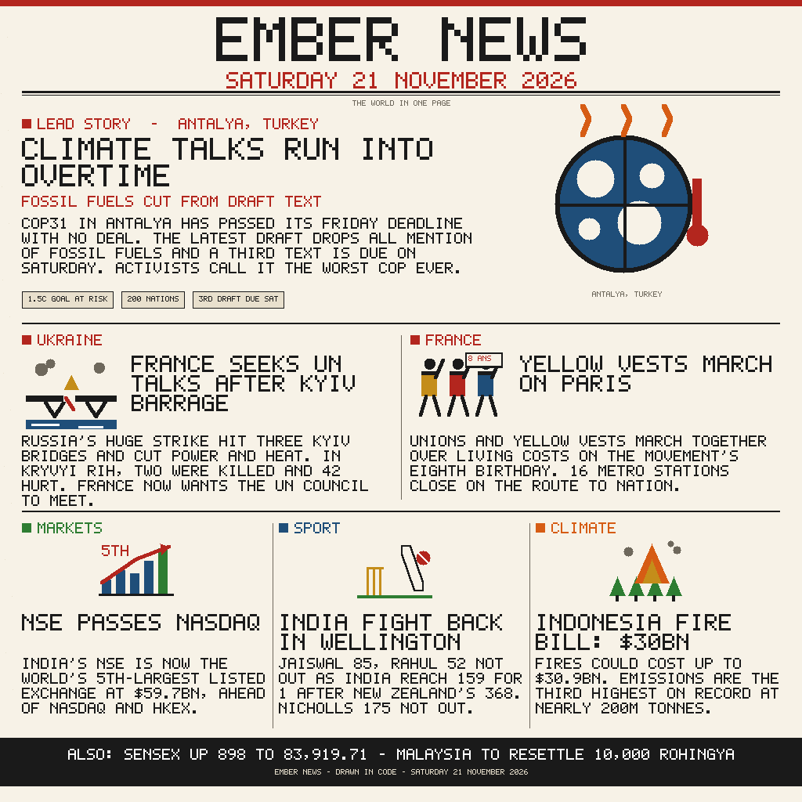

# Ember News 21 November

[](https://make.fun/c/news-image-20261121)
[](https://make.fun/c/news-image-20261121)
[](https://make.fun/c/news-image-20261121)

A one-page front page summing up Saturday 21 November 2026 world news,
drawn entirely in code for the make.fun
[news-image-20261121](https://make.fun/c/news-image-20261121) bounty.



## The day in the image

- **Lead — COP31 runs into overtime in Antalya:** the talks pass their Friday
  deadline with no deal; the latest draft drops all mention of fossil fuels
  and a third text is due on Saturday.
- **Ukraine — France seeks UN talks** after Russia's huge strike hits three
  Kyiv bridges and cuts power and heat; two killed and 42 hurt in Kryvyi Rih.
- **France — Yellow Vests march on Paris** with the unions over living costs,
  on the movement's eighth birthday.
- **Markets — NSE passes Nasdaq** as the world's 5th-largest listed exchange
  at $59.7bn.
- **Sport — India fight back in Wellington:** Jaiswal 85, Rahul 52 not out,
  India 159 for 1 replying to New Zealand's 368.
- **Climate — Indonesia fire bill:** up to $30.9bn in losses; emissions the
  third highest on record at nearly 200m tonnes.

## How it is made

`main.ts` (Node 22, standard library only) plots every pixel itself into a
1024x1024 PNG: a hand-built 5x7 bitmap font, vector-style icons for each
story (globe, bridge, march, chart, cricket, flame), and a deterministic
PNG encoder. No network, no external images. Run it with:

```sh
mkdir -p out && MAKEFUN_OUTPUT_DIR=out node main.ts
```

It writes `out/entry.png` (1024x1024, ~23 KB), byte-identical on every run.

## License

MIT — see [LICENSE](LICENSE).
